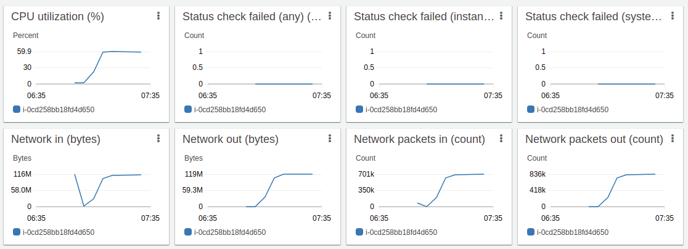
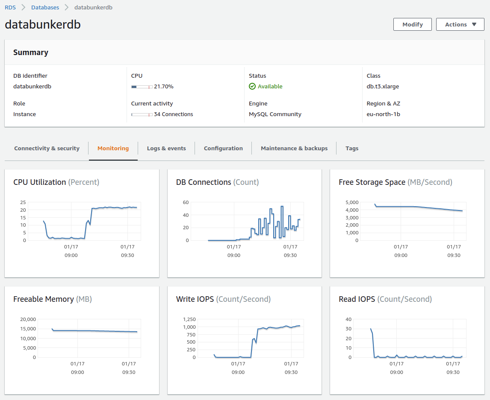

Two tests of the open-source edition: bulk record creation on AWS, and a full read path on a single small server. For Databunker Pro numbers, see [Performance](/pro/get-started/performance).

## Test 1: one million records on AWS EKS and RDS

*Run on 22 January 2022.*

Databunker OSS was deployed on AWS with the [Terraform configuration](https://github.com/securitybunker/databunker/tree/master/terraform/aws) and Helm chart from the repository. A single EKS node ran the Databunker container, and a single MySQL RDS instance held the data.

| Instance sizes (EKS node / RDS) | Sustained rate | Time to create 1M records |
| --- | --- | --- |
| `t3.xlarge` / `db.t3.xlarge` | 347 requests/s | 48 minutes |
| `t3.medium` / `db.t3.medium` | 280 requests/s | 60 minutes |

### Resource utilization (`t3.xlarge`)

<Frame caption="EKS node utilization during the test">
  
</Frame>

<Frame caption="MySQL RDS db.t3.xlarge utilization during the test">
  
</Frame>

### How to reproduce

1. Deploy the stack with the [Terraform configuration for AWS](https://github.com/securitybunker/databunker/tree/master/terraform/aws).
2. Start a separate EC2 instance to run the load script below.

The script runs 100 green threads, and each thread creates 10,000 user records, for one million in total. Each thread uses a `requests.Session()`, so connections are reused; Databunker supports HTTP keep-alive.

```python stress-test.py
import logging
import gevent
from gevent import monkey
monkey.patch_all(httplib=True)
import urllib3
urllib3.disable_warnings(urllib3.exceptions.InsecureRequestWarning)
import requests

token = "YOUR_ROOT_TOKEN"
url = "https://YOUR_LOAD_BALANCER:8443"

logger = logging.getLogger("stresstest")
logger.setLevel(logging.DEBUG)
ch = logging.StreamHandler()
ch.setFormatter(logging.Formatter("%(asctime)s: %(levelname)s: %(message)s"))
logger.addHandler(ch)

def generate(start):
    s = requests.Session()
    for n in range(start * 10000, (start + 1) * 10000):
        if n % 1000 == 0:
            logger.warning("create: " + str(n))
        userobj = {"somekey": "somevalue", "email": str(n) + "@example.com"}
        s.post(url + "/v1/user", data=userobj,
               headers={"X-Bunker-Token": token}, verify=False)
    return start

threads = [gevent.spawn(generate, i) for i in range(100)]
gevent.joinall(threads)
logger.warning("done")
```

## Test 2: full stack on one 1 GB droplet

*Run on 11 April 2021.*

Every component ran on one DigitalOcean droplet with **1 GB RAM, 1 Intel CPU and a 25 GB NVMe SSD**:

1. Databunker, as a Docker container
2. MySQL, as a Docker container
3. A Node.js app server
4. ApacheBench (`ab`) generating the load

This measures the whole read path, not Databunker alone. On each request, Databunker loads the user record from MySQL (`SELECT`), decrypts it, writes an audit event (`INSERT`), and returns the record to the app server, which prints the user's email. The Node.js HTTP agent was configured to reuse open sockets.

**Result: the app server sustained 155 requests per second** while loading every response from Databunker, with no failed requests and a 95th-percentile latency of 95 ms.

### App server

```javascript server.js
const app = require('express')();
const DatabunkerStore = require('@databunker/store');

const databunker = new DatabunkerStore({
  url: 'http://localhost:3000',
  token: 'DEMO'
});

app.get('/', async (req, res) => {
  const user = await databunker.users.get('phone', '4444');
  res.send('user: ' + user.data['email'] + '\n');
});

app.listen(3200, '0.0.0.0');
```

### Load command and output

```bash
ab -n 1000 -c 10 http://0.0.0.0:3200/
```

<Accordion title="Full ApacheBench output">
```text
Concurrency Level:      10
Time taken for tests:   6.416 seconds
Complete requests:      1000
Failed requests:        0
Total transferred:      234000 bytes
HTML transferred:       34000 bytes
Requests per second:    155.86 [#/sec] (mean)
Time per request:       64.162 [ms] (mean)
Time per request:       6.416 [ms] (mean, across all concurrent requests)
Transfer rate:          35.62 [Kbytes/sec] received

Connection Times (ms)
              min  mean[+/-sd] median   max
Connect:        0    0   0.1      0       1
Processing:    11   64  18.0     61     163
Waiting:        7   63  17.1     60     154
Total:         12   64  18.0     61     163

Percentage of the requests served within a certain time (ms)
  50%     61
  66%     66
  75%     72
  80%     76
  90%     85
  95%     95
  98%    113
  99%    128
 100%    163 (longest request)
```
</Accordion>

## Next steps

- [Installation guide](/oss/installation/overview)
- [Security review](/oss/get-started/security)
- [Databunker Pro performance](/pro/get-started/performance)
