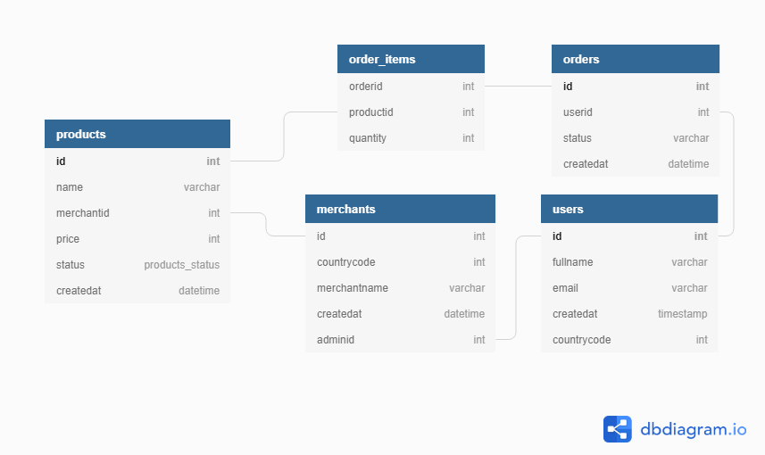
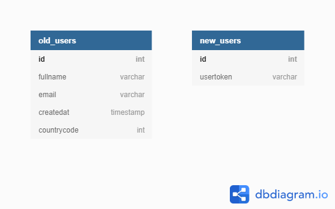
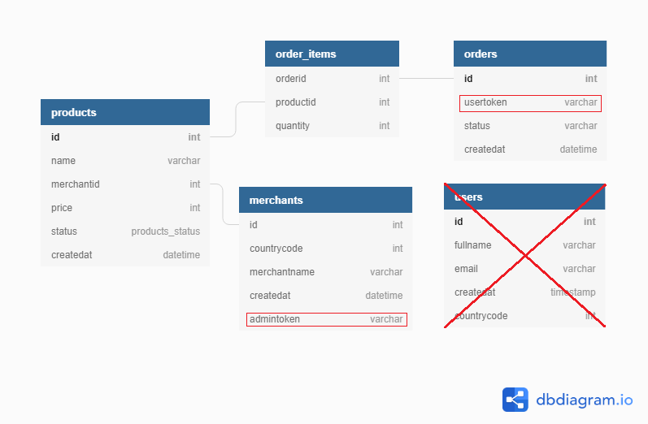

To use Databunker in an existing project, move personal records out of your own tables and into Databunker. Your application then finds a user by their Databunker token, email, login name, phone number or custom index.

## Example schema

In this schema the personal data sits in the `users` table, and other tables reference it by `userid`. After the migration, that personal data lives in Databunker.

<Frame>
  
</Frame>

## Method 1: keep `userid`, add a token

Change only the `users` table. Remove every personal-data column, keep the original `userid` (or `id`) column, and add a `usertoken` column that holds the UUID token Databunker returns when you create the user.

<Frame>
  
</Frame>

This is the right choice for a large database, or when `userid` is referenced by many tables, because nothing outside `users` changes.

The trade-off: each user now has two identifiers, `userid` and `usertoken`.

## Method 2: replace `userid` everywhere

Change every table that references `userid` to reference `usertoken` instead, so the Databunker token becomes the only user identifier.

<Frame>
  
</Frame>

This leaves one identifier per user, but requires more changes to the schema and to application code.

## Next steps

- [Quickstart](/oss/get-started/quickstart)
- [Installation guide](/oss/installation/overview)
- [Databunker Pro: migrate a SQL users table](/pro/migrations/sql-users-table), a step-by-step version of the same pattern
